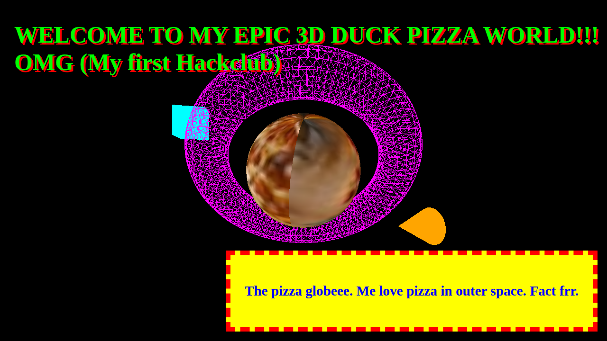
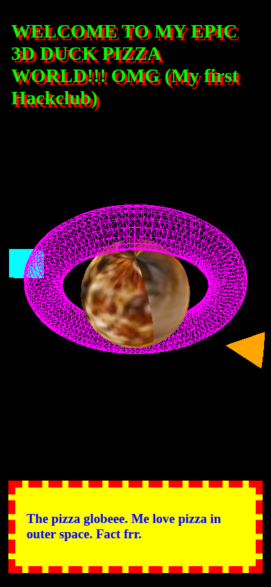
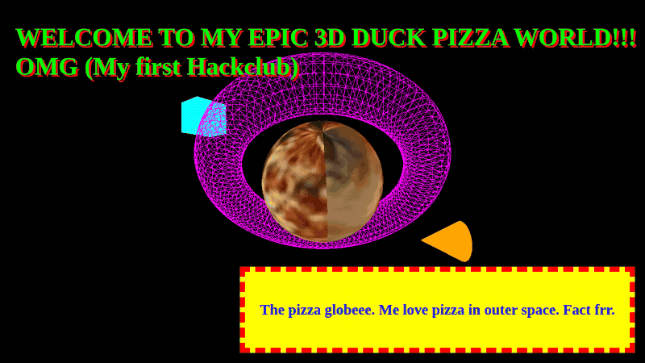

# Space 3D Site

**A pizza planet, a neon donut, a floating cube, and a duck beak — spinning in your browser.**

[](LICENSE)
[](https://github.com/mrdoob/three.js/releases/tag/r128)
[](#tech-stack)
[](https://github.com/ryaneditraj/Space-3d-site/actions/workflows/ci.yml)

Space 3D Site is an open-source Three.js and WebGL demo: one page, no build step, and a 3D scene you can read in a single sitting. Ryan Editraj made it as a first Hack Club project. The page still opens with the original headline: “WELCOME TO MY EPIC 3D DUCK PIZZA WORLD!!! OMG (My first Hackclub)”.

Browser-only · Three.js r128 · MIT License · No API keys · No build step

- [Demo](#demo)
- [Features](#features)
- [Tech stack](#tech-stack)
- [Quick start](#quick-start)
- [Usage](#usage)
- [Project structure](#project-structure)
- [Roadmap](#roadmap)
- [FAQ](#faq)
- [Contributing](#contributing)
- [Security](#security)
- [License](#license)
- [Author](#author)

## Demo

These pictures are from a local run of this repository in Chrome. The scene keeps animating after it loads.



*Desktop, 1280×720. The pizza texture is a real photo, which is why the planet looks soft.*



*Narrow viewport, 390×844. The camera steps back so the cube and the cone stay in frame.*



*About a second and a half of the loop.*

GitHub Pages is not turned on for this repository yet. After it is enabled from the `main` branch root, the public page will be [https://ryaneditraj.github.io/Space-3d-site/](https://ryaneditraj.github.io/Space-3d-site/). Until then, use the quick start below.

## Features

- Full-window WebGL canvas with a pizza-textured sphere, a magenta wireframe torus, a cyan box, and an orange cone
- The cone is the duck beak from the original page
- The cube spins and bobs. The planet, donut, and cone tumble on their own
- The original lime headline and yellow note stay on top of the canvas
- Resizing the window updates the camera. On a narrow screen the camera moves back so the side shapes remain visible. Wide screens stay at the original camera distance (`z = 12`)
- `prefers-reduced-motion: reduce` holds a still frame
- The pizza JPEG is stored in the repo. A normal local server loads that file. Opening `index.html` from disk uses the same JPEG embedded in `js/pizza-texture.js`, because WebGL cannot sample a `file://` image
- Three.js r128 is loaded from cdnjs and pinned with subresource integrity

| Shape | Geometry | Look |
| --- | --- | --- |
| Pizza planet | `SphereGeometry` radius 3 | Photo texture, `MeshBasicMaterial` |
| Donut | `TorusGeometry` radius 5, tube 1 | Magenta wireframe `#ff00ff` |
| Cube | `BoxGeometry` 1.5 | Cyan `#00ffff`, left of center |
| Duck beak | `ConeGeometry` radius 1, height 2 | Orange `#ffa500`, right of center |

## Tech stack

| Piece | Choice |
| --- | --- |
| 3D | [Three.js r128](https://github.com/mrdoob/three.js/releases/tag/r128) (WebGL) |
| Page | HTML, CSS, and vanilla JavaScript |
| Texture | Local JPEG. Provenance is in [`assets/textures/SOURCE.md`](assets/textures/SOURCE.md) |
| Build | None. There is no `package.json` |
| Hosting | Any static host. GitHub Pages from the repository root fits this layout |

Materials are `MeshBasicMaterial`, so they draw their color without lights. The ambient light is still in the scene, from the first version of the page.

## Quick start

You need a current browser with WebGL, and network access so the Three.js file can download. Python 3 is enough for a local server. Node.js is not required to view the scene.

```bash
git clone https://github.com/ryaneditraj/Space-3d-site.git
cd Space-3d-site
python3 -m http.server 8080
```

Open http://127.0.0.1:8080

You can also open `index.html` directly. The shapes, including the pizza texture, still show. Replace `assets/textures/pizza.jpg` when you are serving the folder. The embedded copy is only for the `file://` path, and `scripts/check.sh` checks that the two copies match.

## Usage

The loop starts by itself. There is no score and no camera drag.

1. Watch the four shapes.
2. Resize the window. The canvas follows the viewport.
3. Edit speeds, colors, and positions in [`js/scene.js`](js/scene.js). The original names `sss`, `ccc`, `rrr`, and `spinnySpin` are still there.
4. Reload the page.

Color values live next to each material: donut `0xff00ff`, cube `0x00ffff`, beak `0xffa500`. The WebGL clear color is the renderer default, black. The page background behind the canvas is purple, which you can see if the canvas does not cover the window.

If the operating system asks for reduced motion, the rotations pause and one frame stays on screen.

## Project structure

```
.
├── index.html                 # page, meta tags, JSON-LD
├── css/styles.css             # overlay: purple, lime, yellow, red
├── js/scene.js                # geometries, motion, resize
├── js/pizza-texture.js        # same JPEG, for opening the file directly
├── assets/
│   ├── favicon.svg
│   ├── screenshots/           # stills and GIF from a local Chrome run
│   └── textures/pizza.jpg
├── robots.txt
├── sitemap.xml
├── llms.txt                   # short brief for answer engines
├── LICENSE
├── CONTRIBUTING.md
├── CODE_OF_CONDUCT.md
├── SECURITY.md
├── .env.example               # no variables are required
└── .github/                   # CI, issue forms, pull request template
```

## Roadmap

- [ ] Turn on GitHub Pages for the public demo URL
- [ ] Drag to look around, while the default spin stays
- [ ] A simple duck model in place of the cone
- [ ] A starfield, so the black clear color reads more like space
- [ ] An on-page pause button
- [ ] Sharper rendering with `devicePixelRatio`
- [ ] A Three.js upgrade, checked with side-by-side screenshots
- [ ] Wire up the unused `blinker` keyframes on the headline

## FAQ

### What is Space 3D Site?

Space 3D Site is a small open-source 3D website. It is a creative-coding demo that draws a pizza planet, a wireframe donut, a cube, and a cone in the browser with Three.js and WebGL.

### How do I run this Three.js scene on my computer?

Clone the repository, run `python3 -m http.server 8080` inside it, and open http://127.0.0.1:8080. Opening `index.html` in a desktop browser also works.

### Do I need Node.js, npm, or an API key?

A browser is enough. The scene does not read environment variables, and it does not call an API. Node is used only in GitHub Actions, to syntax-check the scripts and validate the HTML.

### What is in the 3D scene?

Four meshes: a sphere with a pizza photo, a magenta wireframe torus, a cyan box, and an orange cone. The headline calls the cone a duck beak. An ambient light is in the scene. The materials do not use it for shading.

### Which Three.js version does this project use?

Three.js r128, published in April 2021, from `https://cdnjs.cloudflare.com/ajax/libs/three.js/r128/three.min.js`. The script tag includes a `sha384` integrity hash.

### Is Space 3D Site open source?

Yes. It is under the MIT license. See [LICENSE](LICENSE).

### Who made this project?

Ryan Editraj, as a first Hack Club project. GitHub: [github.com/ryaneditraj](https://github.com/ryaneditraj). Instagram: [instagram.com/ryaneditraj](https://instagram.com/ryaneditraj).

### Does the page collect personal data or call external APIs?

The page does not run analytics and does not send form data. The only request to another site is the pinned Three.js file on cdnjs. The pizza image is loaded from this project.

### Can I use this code in my own project?

Yes. MIT lets you use, change, and ship it. Keep the copyright notice from [LICENSE](LICENSE) in substantial copies. The pizza JPEG is under the [Unsplash License](https://unsplash.com/license).

### Why does the pizza planet look blurry?

The texture is a 100×67 JPEG. That is the same small crop the original page requested. It is a style choice from the first version, not a broken download.

### How do I report a security problem?

Use a [private GitHub security advisory](https://github.com/ryaneditraj/Space-3d-site/security/advisories/new). Please skip the public issue list. Details are in [SECURITY.md](SECURITY.md).

## Contributing

Issues and pull requests are welcome. Read [CONTRIBUTING.md](CONTRIBUTING.md) for how to preview a change, and [CODE_OF_CONDUCT.md](CODE_OF_CONDUCT.md) for how to treat people.

Bug reports and ideas can use the issue templates. Vulnerability reports stay private.

## Security

There are no API keys in this repository. The review notes, the Three.js advisory check, and the content security policy are in [SECURITY.md](SECURITY.md).

## License

[MIT](LICENSE) © 2026 Ryan Editraj

## Author

**Ryan Editraj** — AI builder and tech creator.

- GitHub: [@ryaneditraj](https://github.com/ryaneditraj)
- Instagram: [@ryaneditraj](https://instagram.com/ryaneditraj)
- Website: [ryaneditraj.tech](https://ryaneditraj.tech)
